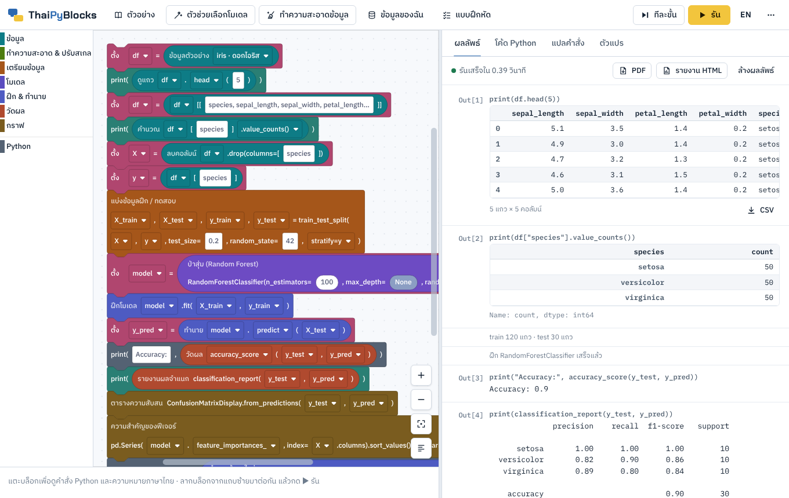

# ThaiPyBlocks

**รุ่นเผยแพร่ 1 · v1.0.0** (แอปเวอร์ชัน 3.8) · ภาษาไทย / English



แอปเรียนเขียนโปรแกรมวิเคราะห์ข้อมูลด้วยการต่อบล็อก (Blockly) ที่ **ทุกบล็อกคือคำสั่ง Python จริง** (pandas, scikit-learn, matplotlib/seaborn, PyThaiNLP)
เลือกชนิดข้อมูลและงานที่ต้องการ แล้วแอปจะต่อบล็อกให้ครบ **รันในเบราว์เซอร์ได้ทันที ไม่ต้องติดตั้ง Python และไม่ต้องมีเซิร์ฟเวอร์**
จากนั้นแปลโปรแกรมออกมาเป็นโค้ด Python, คำอธิบายภาษาไทย/อังกฤษทีละขั้น, ผังงาน, โน้ตบุ๊ก .ipynb, รายงาน HTML หรือไฟล์ PDF ได้

*ThaiPyBlocks is a block-based Python (pandas / scikit-learn) learning studio in Thai and English. Every block is real Python,
programs run in the browser with no install and no server, and the app exports .py / .ipynb / HTML / PDF.
The whole app is one static page, ready for GitHub Pages. This repository also holds the test suites and two classroom worksheets.*

**เปิดใช้งาน:** <https://chayuton.github.io/thaipyblocks/> · **ดาวน์โหลด:** [Releases → v1.0.0](https://github.com/chayuton/thaipyblocks/releases/tag/v1.0.0)
· **ใบงาน:** [K-Means](https://chayuton.github.io/thaipyblocks/worksheets/worksheet1_kmeans.pdf) · [Neural Network](https://chayuton.github.io/thaipyblocks/worksheets/worksheet2_neural_network.pdf)

---

## ใช้ทำอะไรได้บ้าง

- **ตัวช่วยเลือกโมเดล** เลือกทีละขั้น: ชนิดข้อมูล (ตาราง · ข้อความ · อนุกรมเวลา · รูปภาพ) → งาน 13 แบบ → ข้อมูล → ทำความสะอาดและปรับสเกล → วิธีวัดผล
  (แบ่งฝึก/ทดสอบ · cross-validation · GridSearchCV) → โมเดล 24 ตัวของ scikit-learn แล้วกด "สร้างบล็อกและรัน"
- **ตัวช่วยทำความสะอาดข้อมูล** สแกนข้อมูลแล้วเสนอวิธีแก้ทีละเรื่อง: ข้อความที่หมายถึงค่าว่าง ช่องว่างเกิน ตัวพิมพ์ไม่ตรงกัน ชื่อที่สะกดคล้ายกัน
  วันที่หลายรูปแบบ (รวม พ.ศ. และเลขไทย) ตัวเลขที่เก็บเป็นข้อความ แถวซ้ำ ค่าผิดปกติ ค่าว่าง และปรับสเกล (Normalize)
- **บล็อก 117 ชนิด + บล็อก Python มาตรฐาน** ใน 30 หมวด ทุกบล็อกแสดงคำสั่ง Python บนตัวบล็อก · เลือกตาราง คอลัมน์ และค่าในคอลัมน์จากข้อมูลได้โดยไม่ต้องพิมพ์
- **ข้อความภาษาไทย** ตัดคำแบบ PyThaiNLP (newmm, longest, mm, พยางค์, TCC) ตัดคำหยุด นับคำ TF-IDF จำแนกและจัดกลุ่มข้อความ
- **รันแบบโน้ตบุ๊ก Jupyter** ตาราง ค่าตัววัด และกราฟเรียงลงมา · รันทีละขั้นพร้อมไฮไลต์บล็อก · ข้อผิดพลาดเป็นภาษาไทยพร้อมวิธีแก้ · แท็บตัวแปร
- **แปลและส่งออก** โค้ด Python (คอมเมนต์ไทย/อังกฤษ) · คำอธิบายทีละขั้น · ผังงาน · ชุดโค้ด .zip (.py + .ipynb สำหรับ Colab + รายงาน) ·
  รายงาน HTML ไฟล์เดียว · PDF ขนาด A4 (ค้นหาและคัดลอกข้อความไทยได้) · ไฟล์โครงงาน .json · ตาราง CSV
- **ข้อมูล** ชุดตัวอย่างในตัว 10 ชุด (iris, penguins, titanic, tips, mpg, flights, รีวิวภาษาไทย, digits, สมาชิกร้านกาแฟ, คำสั่งซื้อออนไลน์)
  และอัปโหลดไฟล์ CSV / TSV / Excel / JSON ภาษาไทย UTF-8 หรือ TIS-620 ได้ — ไฟล์อยู่ในเบราว์เซอร์ของผู้ใช้เท่านั้น ไม่ถูกส่งไปที่ใด
- **ใช้สอนในห้องเรียน** โครงงานตัวอย่าง 11 โครงงาน · แบบฝึกหัด 21 ข้อ 3 ระดับ ตรวจคำตอบอัตโนมัติ มีคำใบ้และเฉลย · ใบงานพิมพ์แจก 2 ชุด (หัวข้อถัดไป)
- **สองภาษา** ปุ่ม EN / ไทย มุมขวาบน หรือส่งลิงก์ที่ลงท้ายด้วย `#lang=en` · ใช้ได้ทั้งคอมพิวเตอร์ แท็บเล็ต และมือถือ

---

## ใบงานสำหรับผู้สอน (โฟลเดอร์ `worksheets/`)

ใบงาน 2 กิจกรรมให้นักศึกษาต่อบล็อกเอง แบ่งข้อมูลเป็นชุดฝึก (train) กับชุดทดสอบ (test) แล้วตรวจโมเดลกับข้อมูลที่โมเดลไม่เคยเห็น
ข้อมูลทั้งสองชุดเป็นข้อมูลสมมติที่สร้างขึ้นเพื่อการสอน

| ไฟล์ | ใช้ทำอะไร |
| --- | --- |
| [ใบงานที่ 1 K-Means](https://chayuton.github.io/thaipyblocks/worksheets/worksheet1_kmeans.pdf) (A4 6 หน้า) | จัดกลุ่มลูกค้าห้าง 200 คน: หาจำนวนกลุ่มด้วยกราฟ elbow วัด Silhouette กับชุดทดสอบ จัดกลุ่มลูกค้าใหม่ |
| [ใบงานที่ 2 Neural Network](https://chayuton.github.io/thaipyblocks/worksheets/worksheet2_neural_network.pdf) (A4 5 หน้า) | ทำนายการงอกของเมล็ดจากอุณหภูมิและความชื้น: เทียบ LogisticRegression กับ MLPClassifier |
| [ข้อมูล mall_customers.csv](https://chayuton.github.io/thaipyblocks/worksheets/mall_customers.csv) · [seed_germination.csv](https://chayuton.github.io/thaipyblocks/worksheets/seed_germination.csv) | ให้นักศึกษาดาวน์โหลด แล้วอัปโหลดในแอป (ปุ่ม "ข้อมูลของฉัน") |
| [เฉลยสำหรับผู้สอน](https://chayuton.github.io/thaipyblocks/worksheets/answer_key.pdf) · [รวมทุกฉบับ](https://chayuton.github.io/thaipyblocks/worksheets/worksheets_all.pdf) | ค่าที่ควรได้ทุกตาราง กราฟที่ควรเห็น แนวคำตอบ · ไฟล์รวมมีบุ๊กมาร์กแต่ละส่วน |
| `solution_kmeans.json` · `solution_neural_network.json` | เฉลยบล็อก เปิดในแอปที่เมนู ⋯ → เปิดโครงงาน แล้วกด ▶ รัน |

รายละเอียด ผลที่ควรได้ และวิธีสร้างไฟล์ใหม่อยู่ใน [worksheets/README.md](worksheets/README.md)
ลิงก์ในตารางใช้ได้เมื่อเปิด GitHub Pages แล้ว (ถ้าติดตั้งใน repo ของตัวเอง ให้เปลี่ยน `chayuton` เป็นชื่อผู้ใช้ของคุณ)
**ข้อควรรู้:** repo แบบ Public ทุกคนเปิดไฟล์เฉลยได้ ถ้าไม่ต้องการให้นักศึกษาเห็น ให้ลบ `answer_key.pdf`, `worksheets_all.pdf` และ `solution_*.json`
ออกจาก repo ที่ใช้สอน แล้วเก็บไว้ในเครื่องผู้สอน

---

## ติดตั้งบน GitHub Pages ของตัวเอง (ไม่ต้อง build)

แอปที่ build แล้วคือ `index.html` ที่รากของ repo GitHub Pages เปิดไฟล์นี้ได้ทันที ไม่ต้องตั้ง GitHub Actions และไม่ต้องติดตั้งโปรแกรมใดในเครื่อง

### แบบที่ 1: Fork (ง่ายที่สุด) · แอปอยู่ที่ `https://<ชื่อผู้ใช้>.github.io/thaipyblocks/`

1. เปิด <https://github.com/chayuton/thaipyblocks> แล้วกด **Fork** → **Create fork**
2. ใน repo ที่ fork มา ไปที่ **Settings → Pages → Build and deployment → Source: Deploy from a branch** เลือก Branch `main` และโฟลเดอร์ `/ (root)` แล้วกด **Save**
3. รอ 1–2 นาที ลิงก์ของแอปจะแสดงที่ด้านบนของหน้า Pages

### แบบที่ 2: repo ใหม่จากไฟล์ zip (อัปโหลดผ่านหน้าเว็บ)

1. ดาวน์โหลด `thaipyblocks-v1.0.0.zip` จาก [Releases](https://github.com/chayuton/thaipyblocks/releases/tag/v1.0.0) แล้วแตกไฟล์ จะได้โฟลเดอร์ `thaipyblocks`
2. ที่ github.com กด **New** (หรือ **+ → New repository**) ตั้งชื่อ เช่น `thaipyblocks` เลือก **Public** แล้วกด **Create repository**
3. หน้าเว็บของ GitHub อัปโหลดได้ครั้งละไม่เกิน 100 ไฟล์ ชุดนี้มีประมาณ 110 ไฟล์ จึงอัปโหลด 2 รอบ
   (ลิงก์ **uploading an existing file** หรือ **Add file → Upload files**) ใช้ Chrome, Edge หรือ Firefox
   - **รอบที่ 1** เปิดโฟลเดอร์ `thaipyblocks` เลือกทุกอย่าง **ยกเว้นโฟลเดอร์ `test`** ลากไปวางในหน้า repo แล้วกด **Commit changes**
   - **รอบที่ 2** ลากโฟลเดอร์ `test` ไปวาง แล้วกด **Commit changes** (ถ้าไม่ต้องการชุดทดสอบ ข้ามรอบนี้ได้ แอปทำงานครบโดยไม่ต้องมี `test`)
   - ไฟล์ที่ชื่อขึ้นต้นด้วยจุด (`.nojekyll`, `.gitignore`, `.gitattributes`) ถูกซ่อนใน macOS กด ⌘⇧. ใน Finder เพื่อให้แสดงก่อนเลือก
4. เปิด GitHub Pages ตามขั้นที่ 2 ของแบบที่ 1 (repo ชื่อ `<ชื่อผู้ใช้>.github.io` จะได้ลิงก์ `https://<ชื่อผู้ใช้>.github.io/`)

repo แบบ Private ใช้ GitHub Pages ได้เฉพาะบัญชี Pro, Team หรือ Enterprise

### แบบที่ 3: ใช้ git (command line)

สร้าง repo เปล่าที่ github.com ก่อน (ไม่ต้องติ๊ก Add a README) แล้ว

```bash
git clone https://github.com/chayuton/thaipyblocks.git
cd thaipyblocks
git remote set-url origin https://github.com/<ชื่อผู้ใช้>/<ชื่อ-repo>.git
git push -u origin main
```

แล้วเปิด Pages ตามขั้นที่ 2 ของแบบที่ 1 (ใช้ GitHub Desktop ก็ได้: File → Clone repository แล้ว Publish ไปยัง repo ของตัวเอง)

### แบบที่ 4: เพิ่มในเว็บหรือ repo ที่มีอยู่แล้ว · แอปอยู่ที่ `…/thaipyblocks/`

- ลาก **ทั้งโฟลเดอร์** `thaipyblocks` (จาก zip) ลงหน้า repo แล้ว Commit · ถ้า repo เปิด Pages แบบ Deploy from a branch อยู่แล้ว
  เปิด `https://<ชื่อผู้ใช้>.github.io/<ชื่อ-repo>/thaipyblocks/` ได้ทันที ไม่กระทบไฟล์อื่นของ repo
- ถ้า Pages ใช้โฟลเดอร์ `/docs` ให้วางไว้ที่ `docs/thaipyblocks/`
- ถ้าเว็บ build ด้วย GitHub Actions (Hugo, Jekyll, Astro, Next.js ฯลฯ) คัดลอกเฉพาะ `index.html` ไปไว้ในโฟลเดอร์ไฟล์ static ของเว็บ
  เช่น `static/thaipyblocks/index.html` หรือ `public/thaipyblocks/index.html` (ไฟล์เดียวพอ ใบงานคัดลอกโฟลเดอร์ `worksheets` ไปด้วยถ้าต้องการ)
- เปลี่ยนชื่อโฟลเดอร์ได้ ลิงก์จะเปลี่ยนตามชื่อโฟลเดอร์ ไม่มีไฟล์ใดอ้างชื่อนี้

### ให้คนค้นเจอ repo (ไม่บังคับ)

หน้า repo → ไอคอนเฟืองของ **About**
- Description: `ThaiPyBlocks — ต่อบล็อกเรียน Python ภาษาไทย / English ทุกบล็อกคือโค้ด pandas / scikit-learn จริง รันในเบราว์เซอร์`
- Website: ลิงก์ GitHub Pages ของแอป
- Topics: `python` `blockly` `pandas` `scikit-learn` `machine-learning` `data-science` `data-cleaning` `education` `thai` `pythainlp`

---

## เปิดใช้โดยไม่ผ่าน GitHub

ดับเบิลคลิก `index.html` เพื่อเปิดในเบราว์เซอร์ได้เลย ทุกฟังก์ชันทำงานเหมือนบนเว็บ รวมถึงการดาวน์โหลดไฟล์

## สิ่งที่ต้องมี

- เบราว์เซอร์รุ่นใหม่: Chrome, Edge, Firefox หรือ Safari บนคอมพิวเตอร์ แท็บเล็ต หรือมือถือ
- อินเทอร์เน็ตตอนเปิดหน้า แอปโหลด Blockly 13.3.0 จาก `cdn.jsdelivr.net` · ตัวอ่าน Excel (SheetJS 0.18.5) จาก `cdnjs.cloudflare.com`
  เมื่ออัปโหลดไฟล์ .xlsx · ฟอนต์จาก Google Fonts (ถ้าโหลดไม่ได้จะใช้ฟอนต์ของเครื่องแทน)
  ถ้าเครือข่ายของสถานศึกษาปิดกั้น `cdn.jsdelivr.net` แอปจะเปิดไม่ขึ้น ให้ขอผู้ดูแลเครือข่ายเปิดโดเมนนี้
- ไม่ต้องติดตั้ง Python และไม่ต้องมีเซิร์ฟเวอร์ · โค้ดที่ส่งออกรันใน Google Colab, Jupyter หรือ VS Code
  ด้วย `pip install pandas scikit-learn matplotlib seaborn` (และ `pythainlp` เมื่อโปรแกรมตัดคำไทย)

---

## ชุดทดสอบ (โฟลเดอร์ `test/`)

ชุดทดสอบตรวจว่าผลที่แอปคำนวณในเบราว์เซอร์ **ตรงกับ Python จริง** (pandas 3.0.2, scikit-learn 1.8.0, PyThaiNLP 5.3.8)
และทุกหน้าจอทำงานได้ใน Chromium ไม่จำเป็นต่อการใช้งานแอป ใช้เมื่อแก้ซอร์สโค้ดแล้วต้องการตรวจว่าไม่มีอะไรเสีย

**ติดตั้งครั้งแรก** (Python 3.12 ขึ้นไป · Node.js 22 ขึ้นไป · `qpdf` และ `pdftoppm` สำหรับ pdf_test:
`sudo apt install qpdf poppler-utils` หรือ `brew install qpdf poppler`)

```bash
python3 -m venv .venv && . .venv/bin/activate     # Windows: .venv\Scripts\activate
pip install -r requirements.txt
python3 -m playwright install chromium
(cd vendor && npm ci)        # Blockly, SheetJS และฟอนต์ที่เบราว์เซอร์ทดสอบใช้แทนการโหลดจาก CDN
```

**รันทุกชุด** (ใช้เวลาประมาณ 10 นาที บนเครื่อง 2 คอร์ หยุดทันทีที่ชุดใดไม่ผ่าน และแสดงบรรทัดท้ายของ log)

```bash
sh test/run_all.sh
```

หรือรันทีละชุด เช่น `python3 build.py && python3 test/ux_test.py` · ชุดที่เปิดเบราว์เซอร์ใช้ `dist/test.html` ที่ `build.py` สร้าง
ยกเว้น `pages_test.py` ที่เปิด `index.html` ผ่านเว็บเซิร์ฟเวอร์แบบเดียวกับ GitHub Pages

| ชุดทดสอบ (`test/`) | ตรวจอะไร | ผลก่อนเผยแพร่ |
| --- | --- | --- |
| `i18n_tool.py check` | ข้อความไทยทุกข้อความบนหน้าจอผ่าน `TR()` และมีคำแปลภาษาอังกฤษ | 1,667 ข้อความ · ขาด 0 |
| `ui_smoke.py` | โครงงานตัวอย่างทุกโครงงานรันในเบราว์เซอร์ | 11/11 |
| `py_check.py` | โค้ด Python ที่แอปสร้างจากโครงงานตัวอย่างรันใน CPython ได้ค่าตัววัดเท่ากับในแอป | 11/11 |
| `upload_test.py` | อ่านไฟล์ใน `test/files` (CSV, ตัวคั่น `;`, TIS-620, Excel, ข้อความ, อนุกรมเวลา, ภาพ) แล้วรันโปรแกรมจากไฟล์ เทียบกับ Python | 21/21 |
| `wizard_modes.py` | ตัวช่วยเลือกโมเดลแบบ cross-validation, GridSearchCV และตัวเลือกทำความสะอาด เทียบกับ Python | 15/15 |
| `exercises_test.py` | แบบฝึกหัด: โจทย์เริ่มต้นไม่ผ่าน เฉลยผ่าน และโค้ดของเฉลยรันใน Python | 21/21 |
| `clean_test.py` | ตัวช่วยทำความสะอาดข้อมูลและบล็อกหมวดทำความสะอาด: ทุกบรรทัดที่พิมพ์ตรงกับ pandas | 24/24 (3 บรรทัดต่างเฉพาะเศษทศนิยมระดับ 1e-16) |
| `report_test.py` | รายงาน HTML และชุดโค้ด .zip ของโครงงานตัวอย่าง | ผ่าน |
| `worksheet_test.py` | เฉลยใบงานทั้งสองและการทดลองตามใบงานอีก 11 แบบ เทียบกับ scikit-learn | 13/13 |
| `pdf_test.py` | ส่งออก PDF: หน้า A4 ถูกต้อง ค้นหาข้อความไทยได้ ธีมมืด จอมือถือ เบราว์เซอร์รุ่นเก่า | 43/43 |
| `ux_test.py` | ใช้งานจริง: ดาวน์โหลด แก้บล็อก undo ลากบล็อก รันทีละขั้น ตัวช่วยผ่านการคลิก ข้อผิดพลาดภาษาไทย | 52/52 |
| `columns_test.py` | รู้คอลัมน์ของทุกตารางก่อนรัน และตัวเลือกตาราง/คอลัมน์ในบล็อก | 85/85 |
| `lang_test.py` | หน้าจอภาษาอังกฤษไม่มีภาษาไทยหลงเหลือ (ยกเว้นข้อมูล) และสลับภาษาได้ | 40/40 |
| `v38_test.py` | ความสามารถของเวอร์ชัน 3.8: SelectKBest ชื่อสะกดคล้ายกัน วันที่หลายรูปแบบ ตัวตัดคำไทย ตัวเลือกค่า | 21/21 |
| `thai_check.py` | ตัดคำไทย 5 แบบ เทียบกับ PyThaiNLP 5.3.8 | 3,232 ข้อความ × 5 แบบ · ต่าง 0 |
| `engine_cases.js` + `sk_ref.py` | โมเดลและตัววัดผลเทียบกับ scikit-learn ทีละค่า | 21 ชุด · ต่าง 2 ค่าที่ทราบอยู่แล้ว ¹ |
| `search_cases.js` + `search_ref.py` | GridSearchCV และ cross-validation เทียบกับ scikit-learn | 11 ชุด · ต่าง 0 |
| `pages_test.py` | เปิดแอปแบบเดียวกับ GitHub Pages (โฟลเดอร์ `/thaipyblocks/` และรากของเว็บ) แล้วใช้ทุกฟังก์ชัน: โครงงานตัวอย่าง · โปรแกรมจากตัวช่วยเลือกโมเดล 141 แบบ · ตัวช่วยทำความสะอาด · แบบฝึกหัด · อัปโหลดไฟล์ผ่านหน้าต่างเลือกไฟล์ · ดาวน์โหลด PDF / HTML / .zip / โครงงาน · แท็บแปลคำสั่งและตัวแปร · สลับภาษา · จอมือถือ · เปิดจากไฟล์ในเครื่อง | 38/38 |

¹ `coef_` ของ LogisticRegression ต่างที่ทศนิยมตำแหน่งที่ 3 และ `feature_importances_` ของ GradientBoostingClassifier ต่างที่ทศนิยมตำแหน่งที่ 3
บนเครื่องที่มีชุดคำสั่ง AVX-512 · `run_all.sh` ยอมรับ 2 ค่านี้และแสดงไว้ทุกครั้ง

---

## แก้ไขซอร์สโค้ด

แก้ไฟล์ใน `src/` แล้วรัน (ใช้แค่ Python 3 มาตรฐาน ไม่ต้องติดตั้งแพ็กเกจ)

```bash
python3 build.py      # เขียน index.html ใหม่ (และ dist/ สำหรับทดสอบ ซึ่ง git ไม่เก็บ)
```

แล้ว commit ทั้ง `src/` และ `index.html` · GitHub Pages เปิด `index.html` ตรง ๆ ไม่ได้ build จาก `src/` จึงต้อง commit ไฟล์ที่ build ใหม่ทุกครั้ง
(อย่าแก้ `index.html` ด้วยมือ เพราะจะถูกเขียนทับเมื่อ build ครั้งต่อไป) · ก่อน commit ควรรัน `sh test/run_all.sh`

| ไฟล์ / โฟลเดอร์ | คืออะไร |
| --- | --- |
| `index.html` | แอปที่ build แล้ว (ไฟล์เดียว ประมาณ 1.9 MB) เป็นไฟล์ที่ GitHub Pages เปิด |
| `build.py` | รวม `src/` เป็น `index.html` |
| `src/index.html`, `src/ui/styles.css` | โครงหน้า ธีมสว่าง/มืด และ layout คอมพิวเตอร์/มือถือ |
| `src/engine/` | เครื่องคำนวณ JavaScript ที่ให้ผลเหมือน pandas / scikit-learn / NumPy และตัดคำไทยแบบ PyThaiNLP |
| `src/blocks/` | บล็อกทั้งหมด ตัวรันบล็อก ตัวสร้างโค้ด Python และคำอธิบายทีละขั้น |
| `src/ui/` | หน้าจอ: ตัวช่วยเลือกโมเดลและทำความสะอาดข้อมูล แบบฝึกหัด รายงาน PDF การเลือกคอลัมน์ ภาษา |
| `src/data.js`, `src/thai_dict.js` | ชุดข้อมูลตัวอย่าง และพจนานุกรม/คำหยุด/พยางค์ภาษาไทย (ไฟล์ที่สร้างอัตโนมัติ) |
| `src/i18n_en.js` | คำแปลภาษาอังกฤษของทุกข้อความบนหน้าจอ |
| `data/` | ชุดข้อมูลตัวอย่างเป็น CSV และสคริปต์ที่สร้าง `src/data.js` (`prep.py`) และ `src/thai_dict.js` (`thai_dict.py` ต้องมี pythainlp) |
| `test/` | ชุดทดสอบ (หัวข้อด้านบน) · `test/files/` ไฟล์ตัวอย่างสำหรับทดสอบการอัปโหลด · `test/shots.py` ถ่ายภาพหน้าจอ |
| `worksheets/` | ใบงาน K-Means / Neural Network: PDF ข้อมูล เฉลย และสคริปต์สร้างใหม่ |
| `vendor/package.json`, `vendor/package-lock.json` | รุ่นของ Blockly, SheetJS และฟอนต์ที่ชุดทดสอบใช้ (`npm ci`) |
| `requirements.txt` | แพ็กเกจ Python รุ่นที่ใช้ตรวจผล (สำหรับชุดทดสอบเท่านั้น) |
| `docs/screenshot.png` | ภาพหน้าจอใน README (`python3 test/shots.py docs readme` สร้างใหม่) |
| `.nojekyll` | ให้ GitHub Pages ส่งไฟล์ตามเดิมโดยไม่ผ่าน Jekyll |

## ข้อจำกัดที่ควรรู้

- **แท็บ "แปลคำสั่ง" → "ภาษาอื่น"** (ให้ Claude แปลโปรแกรมเป็น R, JavaScript, Julia, SQL ฯลฯ) ใช้ได้เฉพาะเมื่อเปิดแอปภายใน Claude
  บนหน้าเว็บนี้แอปจะแจ้งไว้ ส่วนมุมมอง "ทีละขั้น" และ "ผังงาน" ใช้ได้ตามปกติ
- คำนวณในเบราว์เซอร์ จึงเหมาะกับข้อมูลหลักพันถึงหลักหมื่นแถว (GridSearchCV กับข้อมูลภาพใช้เวลาหลายวินาที) · ไม่มี deep learning (ใช้ MLPClassifier / MLPRegressor แทน)
- ไฟล์ที่อัปโหลดอยู่ในเบราว์เซอร์ของผู้ใช้เท่านั้น ต้องอัปโหลดใหม่เมื่อเปิดหน้าใหม่ · บล็อก ชื่อคอลัมน์ และความคืบหน้าแบบฝึกหัดถูกจำไว้ในเบราว์เซอร์ของเครื่องนั้น
- ถ้านำหน้าเว็บไปฝังใน iframe ของเว็บอื่น ปุ่มดาวน์โหลดจะถูกซ่อน
- ตัวเลขที่ได้ตรงกับ pandas 3.0, scikit-learn 1.8 และ PyThaiNLP 5.3.8 · Python บนเครื่องอื่นอาจต่างเล็กน้อยที่ทศนิยมหลักท้าย ๆ

## เครดิตและสัญญาอนุญาต

- [Blockly](https://github.com/google/blockly) 13.3.0 และ [SheetJS](https://sheetjs.com) 0.18.5 (Apache-2.0) โหลดจาก CDN ตอนเปิดหน้า ·
  ฟอนต์ IBM Plex Sans Thai, IBM Plex Mono และ Chakra Petch (SIL Open Font License) จาก Google Fonts
- ตัวตัดคำไทยพอร์ตจาก [PyThaiNLP](https://github.com/PyThaiNLP/pythainlp) 5.3.8 (Apache-2.0) · บางส่วนของเครื่องคำนวณพอร์ตหรือทำตามขั้นตอนของ
  scikit-learn, LIBSVM, NumPy, pandas และ difflib ของ Python · รายละเอียดและข้อความสัญญาอนุญาตอยู่ใน [THIRD_PARTY_NOTICES.md](THIRD_PARTY_NOTICES.md)
- ชุดข้อมูล iris, penguins, titanic, tips, mpg, flights จาก [seaborn-data](https://github.com/mwaskom/seaborn-data) · digits จาก UCI Optical Recognition
  of Handwritten Digits (ผ่าน scikit-learn) · รีวิวภาษาไทย สมาชิกร้านกาแฟ คำสั่งซื้อออนไลน์ และข้อมูลของใบงาน เป็นข้อมูลสมมติที่สร้างขึ้นสำหรับโครงการนี้
- **สัญญาอนุญาตของ ThaiPyBlocks:** โค้ดในชุดนี้เป็นลิขสิทธิ์ของผู้พัฒนา ถ้าต้องการเปิดให้ผู้อื่นนำไปใช้และแก้ต่อ ให้เพิ่มไฟล์ `LICENSE` ที่ราก repo
  (หน้า repo → **Add file → Create new file** → พิมพ์ชื่อ `LICENSE` → **Choose a license template** เช่น MIT หรือ Apache-2.0)

ประวัติการเปลี่ยนแปลงอยู่ใน [CHANGELOG.md](CHANGELOG.md)
